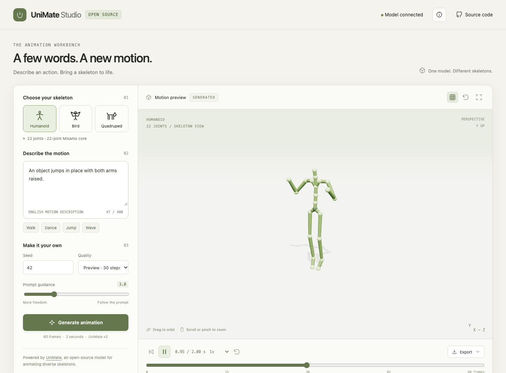

# UniMate Studio

An MIT-licensed **AI text-to-animation workbench** using the real released
[UniMate](https://github.com/Friedrich-M/UniMate) v2 model. Enter an English
action, generate a two-second clip, orbit the skeleton in 3D, scrub individual
frames, and download BVH, JSON or the original UniMate `.npy` motion features.
There are no keyword-to-preset animations and no simulated inference.

Source: https://github.com/HarborneD/unimate-studio

[Try the live prototype](https://linking-perspectives-cir-lyric.trycloudflare.com)
— temporary preview, available while its Mac inference host remains awake.



## What works

- Genuine FLAN-T5 text conditioning and 100k-step UniMate v2 EMA inference.
- Three prepared skeletons: 22-joint humanoid, 26-joint quadruped and bird.
- Seed, classifier-free prompt guidance, 30-step Euler preview or upstream
  adaptive DOPRI5 sampling.
- Orbit/zoom via mouse or touch, play/pause, speed, looping and frame scrubber.
- Saved takes on the inference host, reusable motion exports and provenance.
- Same-origin Python API with real generation progress and explicit errors.
- Responsive desktop/phone UI, keyboard-accessible controls and credits.

The bird and quadruped are original primitive demonstration rigs, supplied to
UniMate as unseen skeletons. They are not Truebones assets. `rigs.py` prepares
small calibration clips because upstream's feature pipeline needs a reference
clip. Those calibration clips are never used as generated takes. The humanoid
uses a locally downloaded Mixamo core rig; source assets are excluded from Git.

## Run locally

Requirements: Python 3.10–3.12, Node 20.19+ or 22.12+, Git, and approximately 4 GB
of disk for dependencies/checkpoints/text encoder. No API key or paid AI service
is required. First setup downloads a roughly 1.2 GB checkpoint and FLAN-T5.

```bash
python3 -m venv .venv
source .venv/bin/activate
pip install 'setuptools<81' wheel
pip install -r requirements.txt --no-build-isolation
npm ci
npm run build
python bootstrap.py
python server.py
# Open http://127.0.0.1:8153
```

To leave a detached local preview running after the terminal closes, use
`python host.py start`; inspect it with `python host.py status`, and stop only
this tool with `python host.py stop`. Logs are written to `server.log`.

On Windows, use `.venv\Scripts\activate` and `python` in place of `python3`.
The portable PyTorch wheels above provide CPU inference. For an NVIDIA host,
install the matching torch/torchvision CUDA wheels from PyTorch's official
index. The adapter chooses CUDA, Apple MPS, then CPU. Override explicitly with
`UNIMATE_DEVICE=cpu python server.py` (or set that environment variable on
Windows). CUDA requires a CUDA-enabled PyTorch install.

Adaptive sampling on Apple MPS uses float32 time arithmetic because MPS cannot
represent torchdiffeq's default float64. The model, drift, solver and upstream
error tolerances are unchanged; this choice is recorded in exported provenance.

The bootstrap pins upstream code, model revision and source dataset revision;
it verifies the checkpoint against the publisher's SHA-256. Everything fetched
lives in ignored `.runtime/`. It runs upstream's actual feature extraction,
then writes a local config with absolute prepared-data paths. Blender and the
upstream captioning/training dependencies are not needed for this subset.

For frontend development: run `python server.py` and `npm run dev`; Vite proxies
`/api` to `127.0.0.1:8153`. The production server serves `build/web` and the API
from the same origin. A static-file server alone cannot provide generation.

## Exports

- **BVH:** canonical skeleton, hierarchy, 30 fps motion; import into Blender or
  other animation tools. It needs retargeting to animate a separate character
  mesh. Joint order is converted from BFS to depth-first for BVH serialization.
- **JSON:** global FK joint positions, local quaternions (`w,x,y,z`), offsets,
  parents, prompt/seed/guidance, device, solver and model provenance. Coordinates
  use Y-up; skeleton scale is canonicalized by UniMate, not original mesh units.
- **NPY:** denormalized `(60, J, 12)` UniMate features compatible with upstream's
  mesh-animation stage when the matching original rig data are available.

Outputs are stored under ignored `output/<take-id>/`, with completed takes
reloaded after restart. A single inference worker serializes access to the
model; a second simultaneous submission receives a busy response.

## Limits

This is a research prototype. Motion can slide, jitter, drift or fail to follow
the prompt; the original demonstration rigs are outside the training skeletons.
The model generates exactly 60 frames at 30 fps. Loop repeats the clip and does
not promise a seamless loop. There is no mesh retargeter, rig uploader, motion
editing, in-betweening or expansion UI in this version. Do not interpret these
as implemented merely because upstream supports them.

Generation runs on the Python host, never inside the browser. Remote links
require that host and its tunnel to remain running. Anyone with a demo URL can
generate a bounded job and see the host's saved demo takes; use public prompts.
For private prompts run it locally or put an authenticated reverse proxy in
front of it. This is not a multi-user production service.

## Checks

Verified on Apple M5 Max / MPS: six real generated takes across all three rigs,
including adaptive bird generation. Warm preview inference took 3.8–4.4 seconds;
adaptive inference took 22.6 seconds. See [verification notes](design/STATUS.md).

```bash
npm run check
python -m unittest discover -s tests
python tests/verify_takes.py
```

The last check needs generated takes and the runtime installed. It checks
finite model output, motion shape, constant FK bone lengths, seed consistency
when matching requests exist, and BVH reload positions against the viewer.
Browser checks use the actual same-origin host and real model jobs.

## Credits / licenses

- UniMate code and checkpoints: MIT, Copyright (c) 2026 Linzhan Mou.
  Authors: Linzhan Mou, Jiahui Lei, Zhiyang Dou, Chenyue Cai, Chaoyue Song,
  Adam Finkelstein and Szymon Rusinkiewicz.
- FLAN-T5: Google, Apache 2.0. Three.js and Motion library: MIT.
- Humanoid conditioning data: Mixamo / Adobe, governed by source terms. The
  bootstrap fetches it for local preparation; this repository does not include
  or relicense raw Mixamo data. Other source packs are not downloaded or bundled.
- Studio code and original demonstration skeleton definitions: MIT.

Upstream paper: *UniMate: One Unified Model to Animate Diverse Skeletons*,
[arXiv:2609.05415](https://arxiv.org/abs/2609.05415), 2026.
